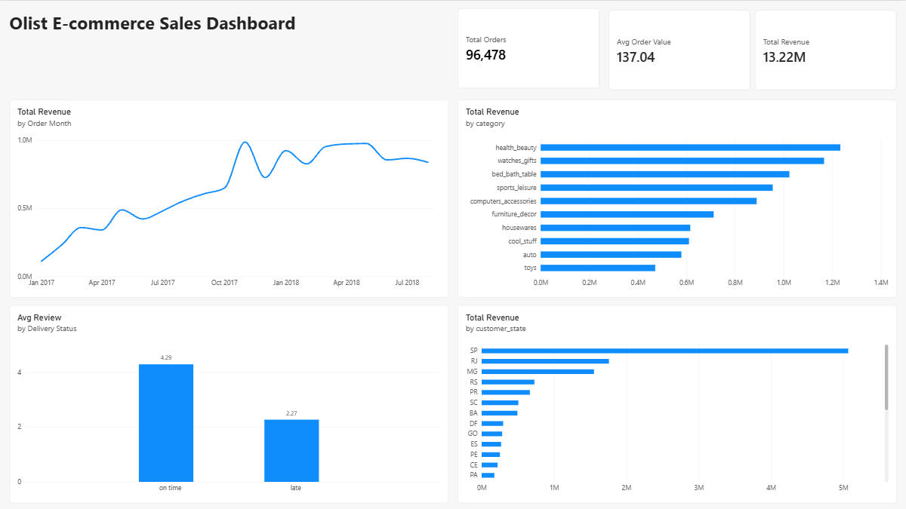

# Olist Retail Sales Analysis (PostgreSQL + Power BI)

An end-to-end sales analysis of the Olist Brazilian e-commerce dataset (about 100k orders, 2016 to 2018). I cleaned the raw tables with SQL views in PostgreSQL. Then I answered five business questions in SQL and built a one-page Power BI dashboard on top of the same view.

*Power BI dashboard: KPI cards (orders, average order value, revenue), monthly revenue trend from 2017, top 10 categories, average review for on-time vs late deliveries, and top 10 states by revenue.*

## Business questions

1. How big is the business: revenue, orders and average order value?
2. How does revenue move month to month, and when does it peak?
3. Which product categories drive revenue?
4. How often are orders delivered late, and what does that do to reviews?
5. Which states bring in the most revenue?

## Key findings

| Metric | Result |
| --- | --- |
| Total revenue (delivered, excl. freight) | R$ 13.22M |
| Orders / items sold | 96,478 / 110,197 |
| Average order value | R$ 137.04 |
| Peak month | November 2017 (R$ 987,765, Black Friday) |
| Top category | health_beauty, R$ 1.23M (9.32% of revenue) |
| Late deliveries | 6.77% of orders |
| Avg review: on time vs late | **4.29 vs 2.27** |
| Top state | São Paulo (SP), 38.32% of revenue |

**The headline insight:** a late delivery takes the average review from 4.29 down to 2.27. Fewer than 7% of orders arrive late, but those orders do outsized damage to ratings. That makes delivery accuracy the clearest lever for customer satisfaction.

## Approach

**1. Data cleaning (SQL views)**, in [`sql/01_views.sql`](sql/01_views.sql):
- `reviews_clean`: some orders had several review rows. I kept one per order with `ROW_NUMBER() OVER (PARTITION BY order_id ...)`, so scores aren't double-counted.
- `products_clean`: translated categories to English with a `LEFT JOIN`. `COALESCE` falls back to `'unknown'`, so no products are dropped.
- `sales_analysis`: one row per item sold, delivered orders only, joining orders, items, customers, products and reviews.

**2. Analysis (SQL)**, in [`sql/02_analysis.sql`](sql/02_analysis.sql):
- KPIs with `COUNT(DISTINCT)` to avoid join fan-out (order grain vs item grain)
- monthly trend with `DATE_TRUNC`
- category and state share of revenue with window functions (`SUM() OVER ()`)
- late vs on-time with `CASE WHEN`, comparing dates by day so same-day deliveries aren't flagged as late

**3. Dashboard (Power BI)**, in `olist_dashboard_my_build.pbix`:
- Imported the `sales_analysis` view from PostgreSQL.
- DAX measures: `Total Revenue`, `Total Orders` (`DISTINCTCOUNT`), `Avg Order Value` (`DIVIDE`), and `Avg Review`. `Avg Review` uses `AVERAGEX` over unique orders, so each order counts once.
- Calculated columns: `Order Month` and `Delivery Status`.
- Visuals: KPI cards, a monthly revenue line, the top 10 categories, review by delivery status, and revenue by state.
- I checked every visual against the SQL results.

## Tools

PostgreSQL (pgAdmin 4) · SQL (CTEs, window functions, joins, CASE) · Power BI Desktop · DAX

## How to reproduce

1. Download the [Olist dataset from Kaggle](https://www.kaggle.com/datasets/olistbr/brazilian-ecommerce).
2. Load the CSVs into PostgreSQL tables (`orders`, `order_items`, `customers`, `products`, `reviews`, `category_translation`).
3. Run `sql/01_views.sql`, then the queries in `sql/02_analysis.sql`.
4. Open `olist_dashboard_my_build.pbix` and point the data source to your database.

## Author

**Tharshan Krishnakumar**, Data Analyst, Dubai · [LinkedIn](https://www.linkedin.com/in/tharshan-krishnakumar)
